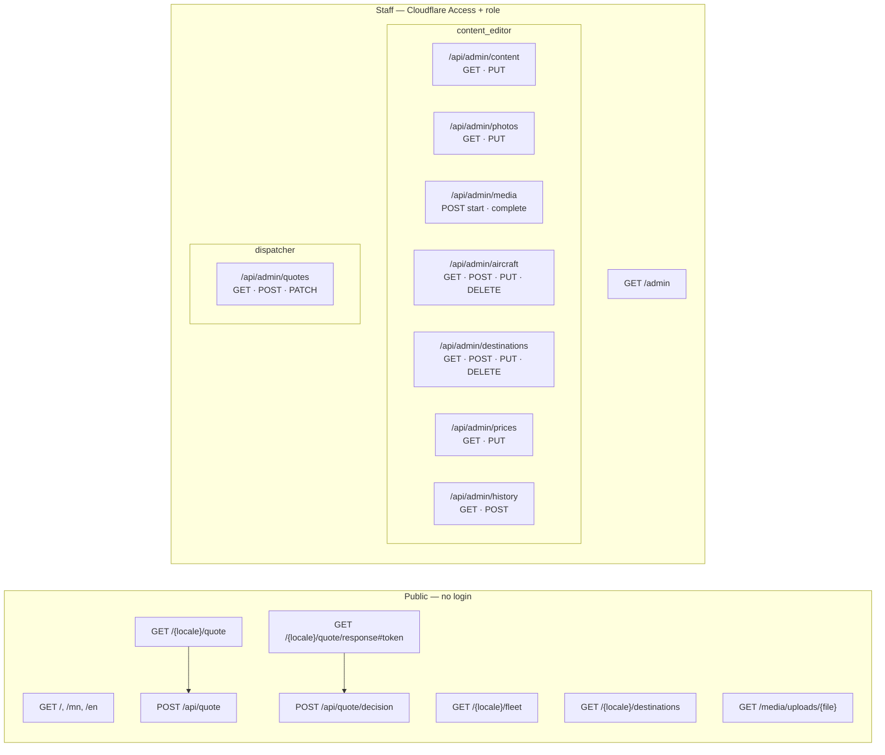

# Pages and API endpoints

All API responses are JSON with `ok: boolean`. Errors carry `error` (admin and quote intake) or `code` (quote decision).

## Endpoint map

`owner` passes every role check. Permanent delete (`?permanent=true`) is owner-only.

## Summary table

| Method | Path | Who | Purpose |
|---|---|---|---|
| GET | `/` | public | Redirect to `/mn` |
| GET | `/{locale}` | public | Home page (`locale` = `mn` or `en`) |
| GET | `/{locale}/fleet` | public | Published aircraft |
| GET | `/{locale}/destinations` | public | Map, published destinations and prices |
| GET | `/{locale}/quote` | public | Flight request form |
| GET | `/{locale}/quote/response#{token}` | client with link | Review and approve/decline a quote |
| POST | `/api/quote` | public | Submit a flight request |
| POST | `/api/quote/decision` | client with token | View, approve or decline a quote |
| GET | `/media/uploads/{file}` | public | Uploaded file via proxy (fallback when no public media URL) |
| GET | `/admin` | staff | Admin dashboard |
| GET | `/api/admin/content` | content_editor | All saved text overrides |
| PUT | `/api/admin/content` | content_editor | Save or reset text overrides |
| GET | `/api/admin/photos` | content_editor | Photo slots + previous image per slot |
| PUT | `/api/admin/photos` | content_editor | Save one photo slot |
| POST | `/api/admin/media` | content_editor | Start a direct upload (signed URL) / verify a finished upload |
| GET | `/api/admin/aircraft` | content_editor | All aircraft (incl. hidden) |
| POST / PUT | `/api/admin/aircraft` | content_editor | Create or update aircraft (upsert) |
| DELETE | `/api/admin/aircraft?id=&permanent=` | content_editor / owner | Hide aircraft, or delete it (owner) |
| GET | `/api/admin/destinations` | content_editor | All destinations (incl. hidden) |
| POST / PUT | `/api/admin/destinations` | content_editor | Create or update destination (upsert) |
| DELETE | `/api/admin/destinations?id=&permanent=` | content_editor / owner | Hide destination, or delete it (owner) |
| GET | `/api/admin/prices` | content_editor | All prices |
| PUT | `/api/admin/prices` | content_editor | Save a price, or reorder prices |
| GET | `/api/admin/history?type=&id=&locale=` | content_editor | Last 20 revisions of one item |
| POST | `/api/admin/history` | content_editor | Restore a previous version |
| GET | `/api/admin/quotes` | dispatcher | Requests, revisions, history, aircraft, prices (expires stale quotes first) |
| POST | `/api/admin/quotes` | dispatcher | Create and email a quote revision |
| PATCH | `/api/admin/quotes` | dispatcher | Review, close, or confirm a request |

---

## Public API

### `POST /api/quote` — submit flight request

Body:

| Field | Type | Rules |
|---|---|---|
| `idempotencyKey` | string | UUID, generated by the form; reuse it on retry |
| `locale` | `"mn" \| "en"` | |
| `name` | string | 2–80 |
| `phone` | string | 6–30 chars of `0-9 + ( ) - space` |
| `email` | string | optional, valid email or `""` |
| `org` | string | optional, ≤120 |
| `from`, `to` | string | 2–120, must differ |
| `roundTrip` | boolean | optional |
| `date` | `YYYY-MM-DD` | today or later (Asia/Ulaanbaatar) |
| `time` | `HH:MM` | optional |
| `pax` | number | 1–20 |
| `notes` | string | optional, ≤1000 |
| `token` | string | Turnstile token |
| `website` | string | honeypot; if filled, returns fake success `Q-0` |

Responses:

| Status | Body | Meaning |
|---|---|---|
| 200 | `{ ok: true, id }` | Saved and at least one alert delivered |
| 400 | `error: bad_json \| invalid \| captcha` | Bad input or failed bot check |
| 409 | `error: idempotency_conflict` | Same key, different data |
| 413 | `error: request_too_large` | Body > 16 KB |
| 429 | `error: rate_limited` | > 5 requests / 10 min per IP (in-process only) |
| 503 | `error: protection_not_configured` | Production without Turnstile secret |
| 503 | `error: persistence_unavailable \| persistence_failed` | Database problem; nothing saved |
| 503 | `{ ok: false, id, error: notification_not_configured \| notification_failed }` | **Saved**, but no alert sent; retry with the same key resends |

### `POST /api/quote/decision` — client views or answers a quote

Headers on every response: `Cache-Control: private, no-store`, `Referrer-Policy: no-referrer`.

Body: `{ token, action }` where `token` is the 72-char value from the email link hash and `action` is `view`, `approve` or `decline`. The server stores only the SHA-256 hash of the token.

| Status | Body |
|---|---|
| 200 (`view`) | `{ ok: true, quote: { id, locale, origin, destination, roundTrip, date, time, passengers, revision, amountMinor, currency, terms, expiresAt, status, bookingStatus } }` |
| 200 (`approve`/`decline`) | `{ ok: true, status, bookingStatus, notificationPending }` |
| 400 | `code: invalid` |
| 404 | `code: invalid` (unknown token) |
| 409 | `code: answered` (already answered or replaced) |
| 410 | `code: expired` (marks revision and quote expired) |
| 503 | `code: unavailable` |

### `GET /media/uploads/{file}`

Fallback proxy, used only when `NEXT_PUBLIC_MEDIA_BASE_URL` is empty (production serves files straight from the bucket's public URL). Only keys under `uploads/` with safe characters. Supports `Range` (206) for video seeking. Returns `Cache-Control: public, max-age=31536000, immutable` and `X-Content-Type-Options: nosniff`. 404 if missing, 503 if storage is not configured.

---

## Admin API

Every admin endpoint:
1. For `POST/PUT/PATCH/DELETE`: rejects with 403 unless the `Origin` header equals the site origin and `Sec-Fetch-Site` is not `cross-site`.
2. Verifies the `Cf-Access-Jwt-Assertion` header (401 if missing/invalid, 503 if Access is not configured).
3. Checks the email is in `ADMIN_ALLOWED_EMAILS` and has a role in `ADMIN_ROLE_MAPPINGS` (401 otherwise).
4. Checks the role is allowed for the endpoint (403 otherwise). `owner` always passes.

Content changes write a `content_revisions` row in the same transaction and revalidate the affected public pages.

### `/api/admin/content`

- `GET` → `{ ok, values: { mn: {key: value}, en: {key: value} } }` (only keys in `CMS_COPY_KEYS`).
- `PUT` body `{ locale: "mn" | "en", values: { [key]: string (≤2000) | null } }`. `null` resets the key to the built-in default (deletes the row). → `{ ok, changed, page }`. 400 if a key is not in `CMS_COPY_KEYS`.

### `/api/admin/photos`

- `GET` → `{ ok, items }`: every slot with its current image, focal point, alt text and the previous image (from the latest revision).
- `GET` items: `{ key, imageKey, posterKey, focalX, focalY, alt: {mn, en}, creditText, creditUrl, updatedAt, previous, previousRevisionId }`.
- `PUT` body `{ key, imageKey, posterKey, focalX, focalY, altMn, altEn, creditText, creditUrl }`.
  - `key`: `hero | membership | corporate | journey-01..07`
  - `imageKey`: `/img/<file>` or a finished upload (image **or video**)
  - `posterKey`: required finished image upload when `imageKey` is a video; ignored for images
  - `focalX/Y`: 0–100; `altMn/En`: 1–300 chars; `creditText` ≤200; `creditUrl` empty or `https://…`

### `POST /api/admin/media` — direct upload (two steps)

1. `{ action: "start", contentType, size, width?, height?, durationMs? }`
   - Types: `image/jpeg|png|webp` (≤10 MB), `video/mp4|webm` (≤50 MB, `durationMs` required, ≤60 s).
   - 30 starts per hour per staff email (in-process).
   - → `{ ok, id, key, uploadUrl, uploadHeaders }`. The browser must `PUT` the file to `uploadUrl` with exactly `uploadHeaders` (Content-Type and Cache-Control are signed; URL valid 15 min).
2. `{ action: "complete", id }` — server checks the stored object's size, type and first bytes.
   - → `{ ok, key, kind, url }`. 409 if not uploaded yet; 400/415 on mismatch (object and row are deleted).

Errors: 400, 413, 415, 429, 503. Files are kept forever (history restore can point at old ones).

### `/api/admin/aircraft`

- `GET` → `{ ok, items: [{ id, name, descriptionMn, descriptionEn, seats, rangeKm, cruiseKmh, payloadKg, imageKey, specificationSource, specificationsVerified, focalX, focalY, altMn, altEn, orderIndex, isPublished }] }`
- `POST` / `PUT` (same handler, upsert by `id`) body = the fields above. Rules: `id` `^[a-z0-9-]{2,80}$`; `seats` 1–30, `rangeKm` 1–20000, `cruiseKmh` 1–1000, `payloadKg` 1–10000 (each nullable); `specificationsVerified: true` needs an `https://` `specificationSource`. Saving always clears `is_placeholder`. → `{ ok, id }`
- `DELETE ?id=<id>` hides it (`is_published = 0`). `&permanent=true` deletes the row (owner only, 403 otherwise). 404 if not found.

### `/api/admin/destinations`

Aircraft and destination `imageKey` must be `/img/<file>` or a finished **image** upload (no video). Same shape as aircraft with: `nameMn`, `nameEn`, `descriptionMn`, `descriptionEn`, `latitude` (−90..90), `longitude` (−180..180), `imageKey`, `focalX`, `focalY`, `altMn`, `altEn`, `coordinateSource`, `coordinatesVerified` (needs `https://` source), `orderIndex`, `isPublished`.

### `/api/admin/prices`

- `GET` → `{ ok, items: [{ id, kind, labelMn, labelEn, noteMn, noteEn, amountMinor, currency, unit, destinationId, aircraftId, isPublished, orderIndex, updatedAt }] }`
- `PUT` save one price: `{ id, kind, labelMn, labelEn, noteMn, noteEn, amount, currency, unit, destinationId, aircraftId, isPublished, orderIndex }`. `amount` is a decimal string (e.g. `"1500.00"`), converted to minor units using the currency's decimals. → `{ ok, id, page }`
- `PUT` reorder: `{ action: "reorder", items: [{ id, orderIndex }] }` (1–100 items, unique ids and orders). → `{ ok }`

### `/api/admin/history`

- `GET ?type=copy|photo|price|aircraft|destination&id=<entityId>&locale=mn|en` → `{ ok, items }` (last 20 revisions, with a short summary in `locale`). For `copy`, `id` is `locale:key` (e.g. `en:heroTitle`).
- `POST { action: "restore", entityType, entityId, revisionId }` restores that revision's `before` snapshot and records the restore as a new revision. → `{ ok }`. 404 if the revision no longer matches the item.

### `/api/admin/quotes`

All responses: `Cache-Control: private, no-store`.

- `GET` first marks overdue sent quotes as `expired`, then returns `{ ok, items (latest 250 quotes), revisions, history, aircraft (assignable), publishedPrices }`.
- `POST` create and send a quote revision. Body `{ id, amount, currency, terms (4–3000), expiresAt (ISO with offset, future) }`. Quote must be `in_review` or `quoted` and have a client email. Needs Resend + `PUBLIC_SITE_URL`.
  1. Saves revision as `draft` with a hashed approval token.
  2. Emails the client a link `/{locale}/quote/response#<token>`.
  3. On success: older `sent` revisions → `superseded`, this one → `sent`, quote → `quoted` (one transaction).
  → `{ ok, revision }`. 502 if email failed (draft kept). 503 if config missing or the quote changed meanwhile.
- `PATCH` workflow action:

| `action` | Body extras | Allowed from | Result |
|---|---|---|---|
| `review` | `note?` | `requested` | `in_review` |
| `close` | `note?` | any except `confirmed` | `closed` |
| `confirm` | `aircraftId`, `operationalApproval: true`, `note` (10–500) | `approved` | `confirmed`; aircraft must be published, non-placeholder, verified, with seats ≥ passengers; emails client + alerts ops |

→ `{ ok, status, notificationPending }`. 409 if the status changed meanwhile.
