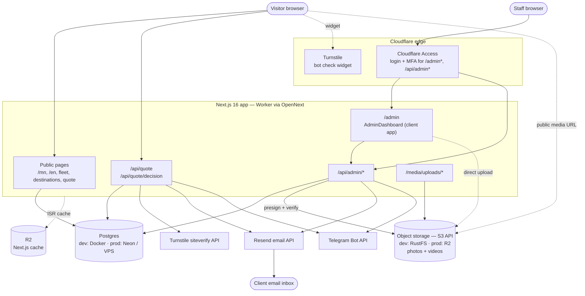
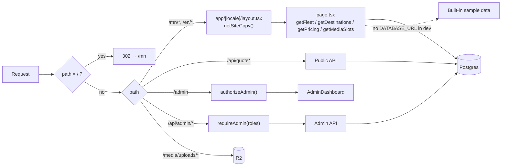
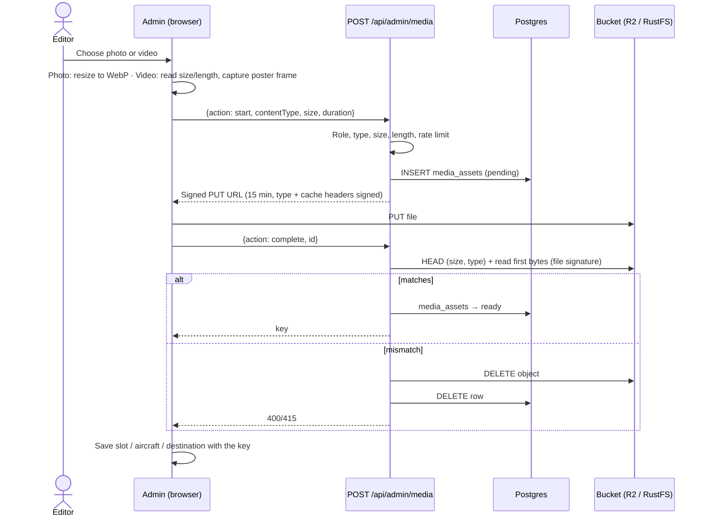

# Architecture

## System overview

## Portability status

| Piece | Now | Portable? | Plan |
|---|---|---|---|
| Database | Postgres via `pg` (`lib/db.ts`) | Yes | Done |
| Uploaded photos/videos | S3 API (`lib/storage.ts`): RustFS locally, R2 in production | Yes | Done |
| Next.js cache | R2 via OpenNext | No | Default Next.js cache on Node |
| Admin auth | Cloudflare Access JWT | No | In-app login (email + password + MFA), sessions in Postgres |
| Hosting | Cloudflare Worker (OpenNext) | No | `next build` + Dockerfile |
| Email / Telegram / Turnstile | HTTP APIs | Yes | — |

## Request paths

## Code layout

| Path | Role |
|---|---|
| `app/[locale]/` | Public pages (locale = `mn` or `en`, nothing else allowed) |
| `app/admin/` | Admin page: checks auth on the server, then renders `components/AdminDashboard.tsx` |
| `app/api/quote/` | Public quote form intake and client approve/decline |
| `app/api/admin/` | Staff API (one folder per resource) |
| `app/media/[...key]/` | Fallback proxy for uploads (with HTTP Range) when no public media URL is set |
| `lib/db.ts` | Postgres pool + `prepare/bind/all/first/run`, `batch`, `transaction` |
| `lib/storage.ts` | S3 client, presigned upload URLs, object checks |
| `lib/media.ts` | Browser-safe media types, limits, `mediaUrl`, default photo slots |
| `lib/media-assets.ts` | Checks a key is a finished upload before content can use it |
| `components/MediaView.tsx` | Renders a slot as `` or muted looping `<video>` (paused for reduced motion) |
| `lib/content.ts` | Public data loaders with sample-data fallbacks |
| `lib/admin.ts`, `lib/admin-api.ts` | Access JWT verification, role checks, same-origin checks |
| `lib/i18n.ts` | Public dictionary + `CMS_COPY_KEYS` (editable text keys) |
| `lib/cms-fields.ts` | Groups editable text keys into admin form sections |
| `lib/admin-dictionary.ts` | Admin UI text (mn/en) |
| `lib/notifications.ts` | Telegram + Resend delivery and delivery logging |
| `lib/content-revisions.ts` | Writes `content_revisions` rows |
| `lib/money.ts` | Integer minor units ↔ display amounts |
| `migrations/`, `scripts/migrate.mjs` | Postgres schema and migration runner |

## Environment variables

| Name | Where | Used for |
|---|---|---|
| `DATABASE_URL` | `.env.local` / secret | Postgres connection |
| `S3_ENDPOINT`, `S3_REGION`, `S3_BUCKET` | `.env.local` / env | Object storage (R2: `https://<account>.r2.cloudflarestorage.com`, region `auto`) |
| `S3_ACCESS_KEY_ID`, `S3_SECRET_ACCESS_KEY` | `.env.local` / secret | Storage credentials (R2 API token) |
| `NEXT_PUBLIC_MEDIA_BASE_URL` | build time | Public bucket URL used in pages; empty → `/media/*` proxy |
| `S3_CORS_ORIGINS` | setup script only | Origins allowed to upload (defaults to `PUBLIC_SITE_URL`) |
| `PUBLIC_SITE_URL` | `.dev.vars` / Worker var | Base URL in quote emails; must be HTTPS in production |
| `CF_ACCESS_TEAM_DOMAIN`, `CF_ACCESS_AUD` | Worker var | Access JWT verification |
| `ADMIN_ALLOWED_EMAILS` | Worker var | Comma-separated staff emails |
| `ADMIN_ROLE_MAPPINGS` | Worker var | `email:role,...` (`owner`, `dispatcher`, `content_editor`) |
| `NEXT_PUBLIC_TURNSTILE_SITE_KEY` | build time | Turnstile widget |
| `TURNSTILE_SECRET_KEY` | secret | Turnstile verification (required in production) |
| `RESEND_API_KEY`, `QUOTE_FROM_EMAIL`, `QUOTE_TO_EMAIL` | secret | Email to ops and clients |
| `TELEGRAM_BOT_TOKEN`, `TELEGRAM_CHAT_ID` | secret | Ops alerts |
| `NEXT_PUBLIC_BRAND` | `.env.local` | Brand name |
| `NEXT_PUBLIC_TILE_URL`, `NEXT_PUBLIC_TILE_ATTRIBUTION` | `.env.local` | Map tiles |
| `OPENWEATHER_API_KEY` | `.env.local` | Weather widget (hidden when empty) |

## File uploads

Files never pass through the app server (Vercel limits request bodies to 4.5 MB). The browser uploads straight to the bucket with a short-lived signed URL; the server only signs and then verifies.

Limits: images 10 MB (JPEG, PNG, WebP; resized to WebP ≤2400 px in the browser), videos 50 MB and 60 s (MP4, WebM). Videos are only allowed in photo slots and always carry a poster image. Old files are never deleted, so history restore keeps working. Abandoned `pending` uploads are not cleaned up yet.
