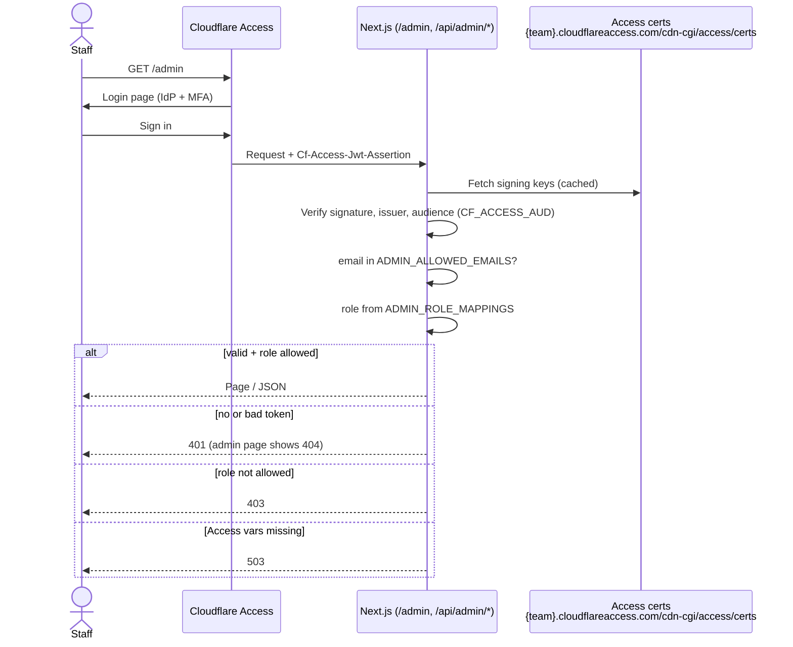
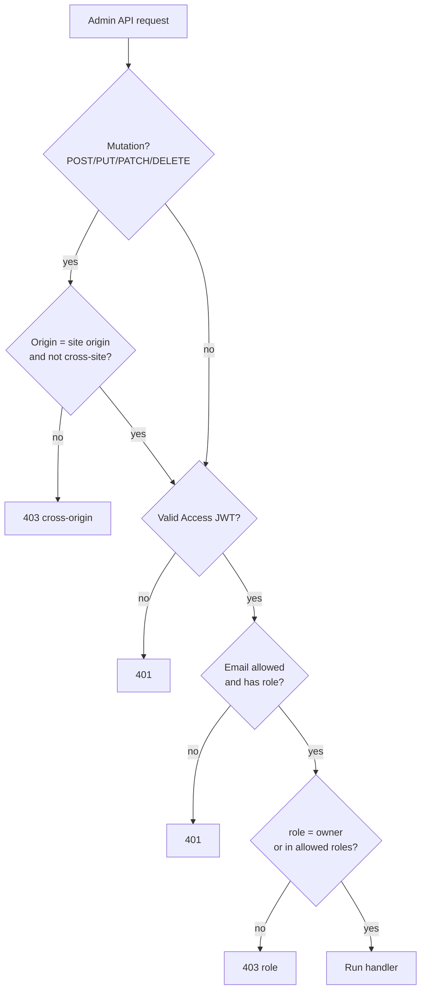
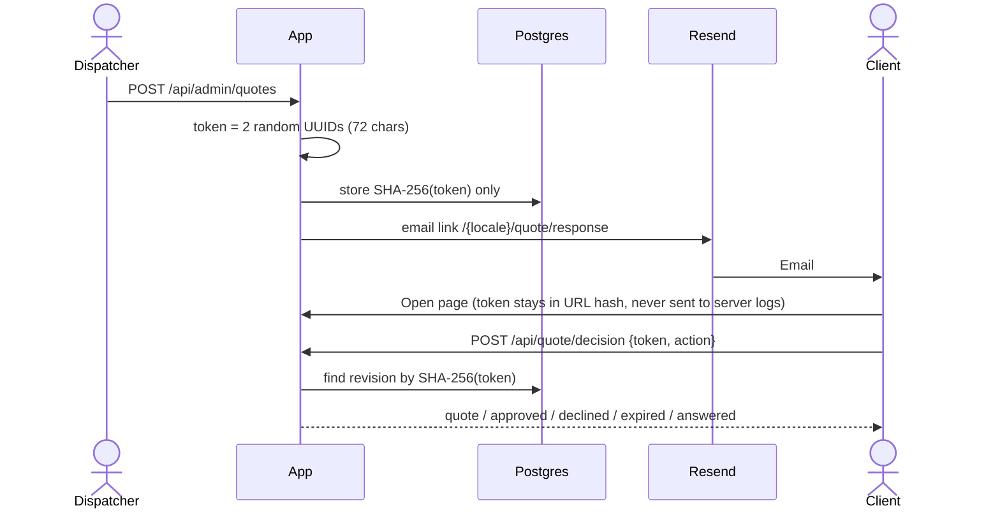

# Auth and protection

There are three separate mechanisms. Only staff have accounts.

| Who | Mechanism | Code |
|---|---|---|
| Staff | Cloudflare Access (login + MFA) → JWT → email allowlist → role | `lib/admin.ts`, `lib/admin-api.ts` |
| Client answering a quote | Single-use, expiring secret link (capability token) | `app/api/quote/decision/route.ts` |
| Public quote form | Turnstile + honeypot + rate limit + idempotency key | `app/api/quote/route.ts` |

## Staff login

The app has no login page. Cloudflare Access sits in front of `/admin*` and `/api/admin*`, signs the staff member in (with MFA, set in the Access policy), and adds a signed JWT header to every request.



### Admin request checks (`requireAdmin`)



### Roles

| Role | Can do |
|---|---|
| `owner` | Everything, including permanent delete of aircraft/destinations |
| `content_editor` | Text, photos, uploads, aircraft, destinations, prices, history/restore |
| `dispatcher` | Flight requests: review, send quotes, confirm, close |

Config example:

```text
ADMIN_ALLOWED_EMAILS=owner@example.com,ops@example.com,editor@example.com
ADMIN_ROLE_MAPPINGS=owner@example.com:owner,ops@example.com:dispatcher,editor@example.com:content_editor
```

A malformed mapping makes all admin requests fail with 503 (fail closed).

## Client quote link



- The token is in the URL **hash**, so it is not sent in the page request or `Referer`.
- Only the hash is stored; a database leak does not reveal working links.
- Single use: approve/decline only works while the revision is `sent` and the quote is `quoted`.
- Expiring: after `expires_at` the link returns 410.
- A newer revision supersedes the old link.
- Client approval is **not** flight confirmation; a dispatcher must confirm.

## Public form protection

| Layer | Detail |
|---|---|
| Turnstile | Verified server-side; production refuses requests if the secret is missing |
| Honeypot | Hidden `website` field; bots get a fake success |
| Rate limit | 5 per 10 min per IP, in memory (resets on restart, not shared) — add an edge/proxy rule |
| Size limit | 16 KB body |
| Idempotency | Same `idempotencyKey` returns the same quote; different data → 409 |

## Planned change (VPS portability)

Cloudflare Access only works behind Cloudflare. To move to a VPS, staff login will move into the app: email + password + TOTP MFA, sessions stored in Postgres, same three roles and the same `requireAdmin(request, roles)` interface so route handlers do not change.
