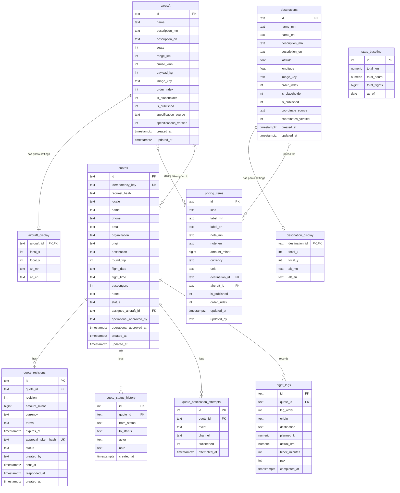
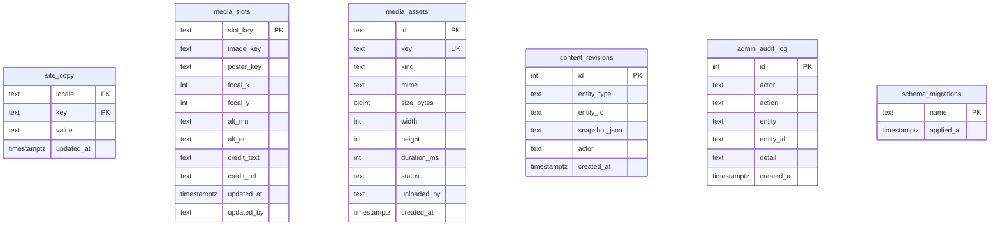

# Database

Postgres. Schema migrations are applied by `npm run db:migrate` and tracked in `schema_migrations`.

Conventions:
- Yes/no flags are `INTEGER` 0/1 with a `CHECK`, not `BOOLEAN`.
- Timestamps are `TIMESTAMPTZ`; the app reads them as ISO strings.
- Money is `BIGINT` minor units (e.g. cents) plus a 3-letter `currency`.
- Bilingual text is two columns: `*_mn` and `*_en`.

## ERD



`0006_total_km_stats.sql` adds the WGS-84 mean-radius `haversine_km` helper, historical baseline, completed-leg stats view and audited leg/baseline tables. It backfills planned legs for existing charter requests (including return legs), using only unique published destinations with verified coordinates. Missing or ambiguous coordinates leave `planned_km` null. The exact stats predicate is `legs.completed_at IS NOT NULL AND booking.status = 'completed' AND booking.service = 'charter'`; distance uses `COALESCE(actual_km, planned_km)`, and each matching leg contributes one flight. Accepted, confirmed, declined, expired and closed bookings are not counted; there is no separate `cancelled` status in the current quote status constraint. RLS denies direct anonymous table access; staff APIs set transaction-scoped roles, and the public endpoint reads only the aggregate view.

The app's `closed` status is treated as cancellation for stats; each completed route leg counts as one flight, so round trips count twice. A route without a unique published, coordinate-verified destination match is retained with a null planned distance until operations records the actual distance.

To reverse just this feature, run `npm run db:rollback:stats`. This removes flight-leg and baseline data and reverts bookings marked completed to confirmed; export the stats and review affected bookings before rollback.

Run integration checks against a disposable migrated Postgres database whose database name includes `test`:

```powershell
$env:TEST_DATABASE_URL = "postgres://.../ajet_test"
$env:DATABASE_URL = $env:TEST_DATABASE_URL
npm run db:migrate
npm run test:total-km
```

Tables with no foreign keys (linked by convention only):



- `content_revisions.entity_type` + `entity_id` point at a row in `site_copy` (`entity_id` = `locale:key`), `media_slots`, `pricing_items`, `aircraft` or `destinations`. `snapshot_json` = `{"before": {...} | null, "after": {...} | null}`.
- `admin_audit_log.entity_id` holds a quote id for quote actions.
- `media_slots.image_key` / `aircraft.image_key` / `destinations.image_key` / `media_slots.poster_key`: `/img/...` = static file in `public/`; `uploads/<uuid>.<ext>` = object in the bucket, matching a `media_assets.key` with `status = 'ready'` (checked on save). A slot whose `image_key` ends in `.mp4`/`.webm` is a video and must have a `poster_key` image.
- `media_slots.credit_text` / `credit_url`: attribution shown in the site footer (deduplicated). Cleared in the admin when a new file is uploaded to the slot.

## Table groups

| Group | Tables | Written by |
|---|---|---|
| Website content | `site_copy`, `media_slots` | Admin: Text, Photos |
| Uploads | `media_assets` | Admin upload (any photo picker) |
| Catalog | `aircraft`, `aircraft_display`, `destinations`, `destination_display`, `pricing_items` | Admin: Fleet, Destinations, Prices |
| Quote workflow | `quotes`, `quote_revisions`, `quote_status_history`, `quote_notification_attempts` | Public form, client link, Admin: Requests |
| Logs | `content_revisions`, `admin_audit_log` | Every content change / quote staff action |

## Allowed values

| Column | Values |
|---|---|
| `quotes.status` | `requested`, `in_review`, `quoted`, `approved`, `confirmed`, `declined`, `expired`, `closed` |
| `quote_revisions.status` | `draft`, `sent`, `approved`, `declined`, `expired`, `superseded` |
| `quote_notification_attempts.event` | `request_received`, `quote_sent`, `client_approved`, `client_declined`, `flight_confirmed` |
| `quote_notification_attempts.channel` | `telegram`, `email` |
| `pricing_items.kind` | `route`, `hourly`, `membership`, `other` |
| `pricing_items.unit` | `per_flight`, `per_hour`, `per_package` |
| `content_revisions.entity_type` | `copy`, `photo`, `price`, `aircraft`, `destination` |
| `media_assets.kind` / `status` | `image`, `video` / `pending`, `ready` |
| `media_slots.slot_key` | `hero`, `membership`, `corporate`, `journey-01` … `journey-07` |
| `locale` | `mn`, `en` |
| `quotes.passengers` | 1–20 |
| `focal_x`, `focal_y` | 0–100 (percent) |

## Public visibility rules

- Only rows with `is_published = 1` appear on the public site.
- Aircraft specs (seats, range, speed, payload) are shown only when `specifications_verified = 1`.
- Destination coordinates source is shown only when `coordinates_verified = 1`.
- Rows with `is_placeholder = 1` are seed data; a placeholder aircraft cannot be assigned to a confirmed flight.

## Seed data

Migration 0001 inserts: 1 placeholder aircraft (`sample-1`), 4 placeholder destinations (`ub`, `terelj`, `khuvsgul`, `gobi`), 10 media slots pointing to `/img/*` files, and the `priceDisclaimer` text in both languages. No prices are seeded.
