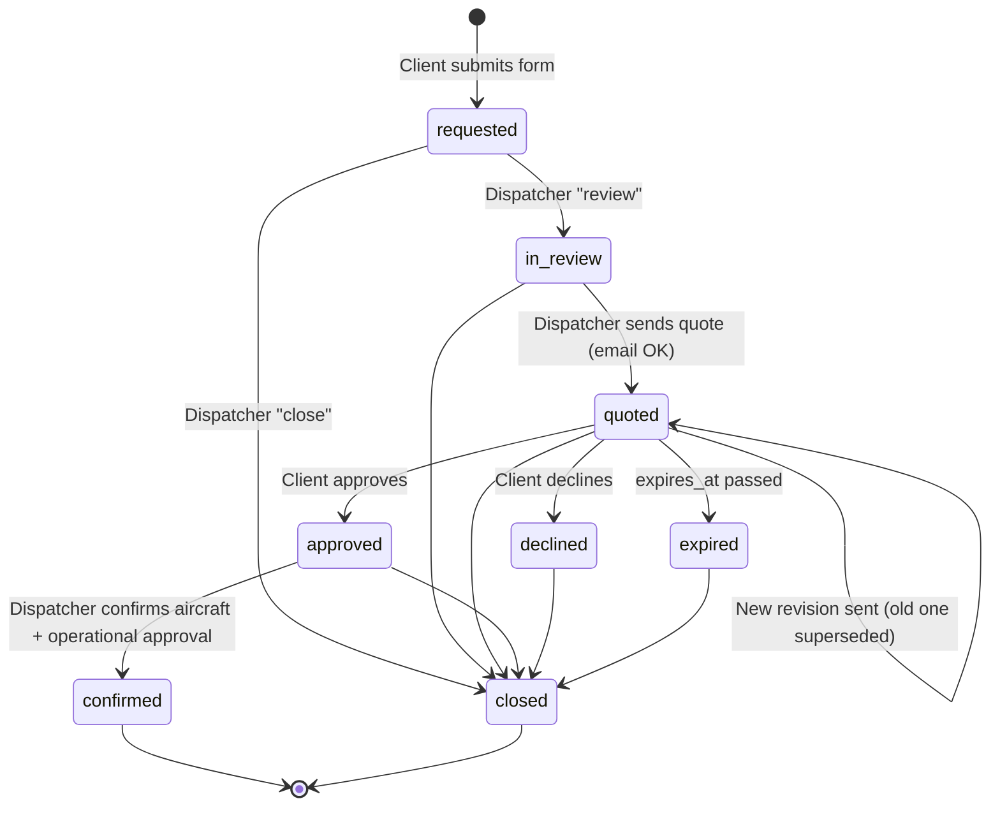
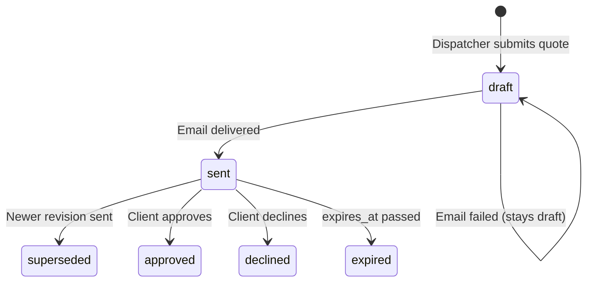
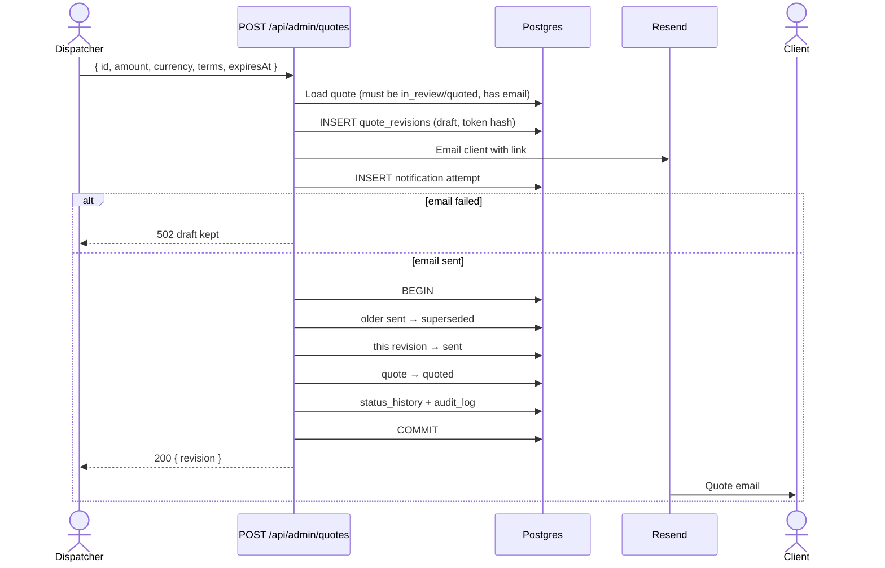
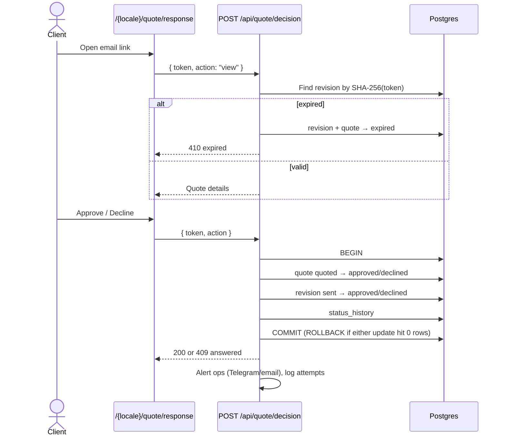
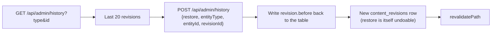

# Main flows

## Quote request lifecycle (`quotes.status`)



Every transition writes a `quote_status_history` row. Staff actions also write `admin_audit_log`.

## Quote revision lifecycle (`quote_revisions.status`)



Expiry is applied lazily: when a dispatcher loads `GET /api/admin/quotes` or a client opens the link. There is no background job.

## 1. Client submits a flight request

```mermaid
sequenceDiagram
    actor C as Client
    participant F as Quote form
    participant API as POST /api/quote
    participant TS as Turnstile
    participant DB as Postgres
    participant TG as Telegram
    participant RS as Resend

    C->>F: Fill form
    F->>API: JSON + idempotencyKey + Turnstile token
    API->>API: Rate limit, size, honeypot, zod validation
    API->>TS: siteverify(token)
    TS-->>API: success
    API->>DB: Find quote by idempotencyKey
    alt new key
        API->>DB: BEGIN; INSERT quotes; INSERT status_history; COMMIT
    else same key, same data
        Note over API: Reuse existing quote id
    else same key, different data
        API-->>F: 409 idempotency_conflict
    end
    API->>DB: Which channels already delivered?
    par Not yet delivered
        API->>TG: Alert ops
        API->>RS: Email ops
    end
    API->>DB: INSERT quote_notification_attempts
    alt any channel delivered
        API-->>F: 200 { ok, id }
    else none delivered
        API-->>F: 503 { id, notification_failed } — saved, safe to retry
    end
```

## 2. Dispatcher sends a quote



## 3. Client approves or declines



## 4. Dispatcher confirms the flight

```mermaid
sequenceDiagram
    actor D as Dispatcher
    participant API as PATCH /api/admin/quotes
    participant DB as Postgres

    D->>API: { action: confirm, id, aircraftId, operationalApproval: true, note }
    API->>DB: Quote must be approved
    API->>DB: Aircraft published, not placeholder, verified, seats ≥ passengers
    API->>DB: BEGIN; quote → confirmed (+ aircraft, approver, time); history; audit; COMMIT
    API->>API: Email client + alert ops, log attempts
    API-->>D: { ok, status: confirmed, notificationPending }
```

Confirmation is a human attestation. The app does not check crew, maintenance, airspace, weather or aircraft availability.

## 5. Editor changes content

```mermaid
sequenceDiagram
    actor E as Editor
    participant UI as AdminDashboard
    participant API as /api/admin/{content,photos,aircraft,destinations,prices}
    participant DB as Postgres
    participant N as Next.js cache

    E->>UI: Edit and save
    opt new photo
        UI->>UI: Resize in browser
        UI->>API: POST /api/admin/media (file)
        API-->>UI: { key: uploads/uuid.jpg }
    end
    UI->>API: PUT/POST item
    API->>DB: Read current row (before)
    API->>DB: BEGIN; upsert row; INSERT content_revisions {before, after}; COMMIT
    API->>N: revalidatePath(affected pages)
    API-->>UI: { ok }
```

## 6. Restore a previous version


